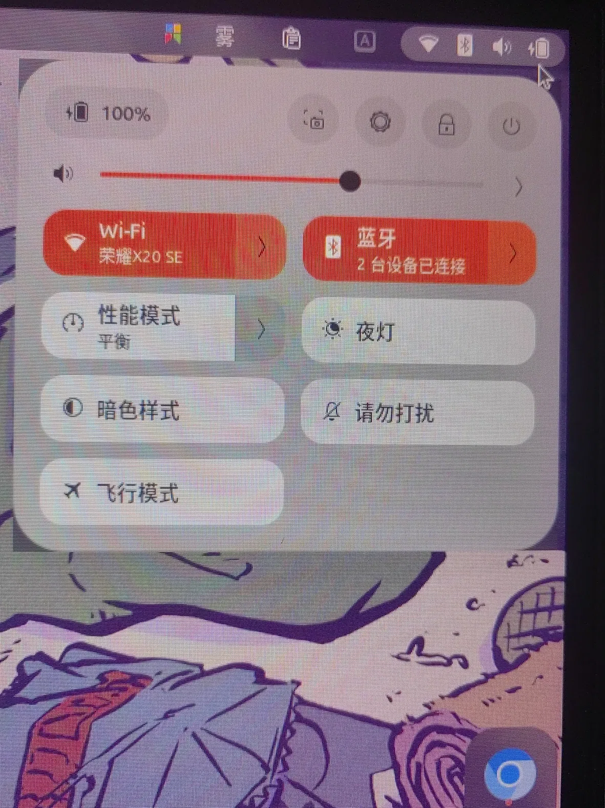

从你提供的图片来看，Ubuntu 26.04 快速设置面板出现了明显的红色/橙色色块与文字重
影，这通常是 Linux 内核 7.0 与 GNOME 50 在部分硬件上出现的图形渲染兼容性问题。

### 🛠️ 排查步骤与解决方案

**1. 排查 GNOME 扩展干扰**某些扩展（如 `blur-my-shell`）的代码 bug 可能导致残
影。
* **操作**：进入“扩展”应用禁用非官方扩展，**必须注销并重新登录**（仅重启 GNOME
  Shell 通常无效）。

**2. 切换显示协议（Wayland / Xorg）**当前 Wayland 会话可能存在渲染 bug，切换会话
类型可快速判断问题是否出在合成器层面。
* **操作**：在登录界面点击右下角齿轮，选择 **Ubuntu on Xorg** 登录。

**3. 调整内核驱动参数（Intel / AMD 平台）**针对 Intel 显卡，可尝试禁用 PSR（面板
自刷新）和 DC（显示控制器）功能。
* **操作**：编辑 `/etc/default/grub`，在 `GRUB_CMDLINE_LINUX_DEFAULT` 引号内添加
  `i915.enable_psr=0 i915.enable_dc=0`，保存后执行 `sudo update-grub` 并重启。

**4. 回退 `linux-firmware` 固件包**固件版本不匹配可能导致屏幕显示异常色块。
* **操作**：先执行 `sudo apt install linux-firmware=0ubuntu2.26` 降级，然后执行
  `sudo update-initramfs -u` 并重启。

**5. 重置 Mutter 渲染参数**某些参数异常可能导致闪烁或残影。
* **操作**：终端执行 `gsettings reset org.gnome.mutter check-alive-timeout`，然
  后重启系统。

**6. 检查多显示器设置**如果连接了多个显示器，GNOME 的渲染错误可能只出现在多屏环
境下。
* **操作**：尝试只保留一个显示器，观察问题是否复现。若消失，可优先排查线材或接口
  问题。

---

如果以上方法均未解决，建议在 [Ubuntu
Launchpad](https://bugs.launchpad.net/ubuntu) 提交 bug 报告，并附上 `journalctl
-b | grep -i "gbm_surface\|Failed to query buffer"` 的日志输出。

如果你方便告知具体的显卡型号（如 Intel UHD 630 或 AMD Radeon），我可以提供更精准
的参数建议。