### GNOME 插件管理概述

- __GNOME桌面扩展__：通过`gnome-shell-extensions`管理桌面扩展，这些扩展可以增强
桌面功能。虽然这些工具功能强大，但命令行操作可能对部分用户不够直观，因此桌面端工
具的需求随之产生。

  ```bash
  sudo apt install gnome-shell-extensions
  ```

### 🧰 安装前的准备

在开始之前，我们需要确保系统上安装了 GNOME Tweaks 工具（也称为“优化”），它可以帮
助我们管理和启用扩展。

1.  __安装 GNOME Tweaks__ (如果尚未安装):打开终端，运行以下命令：
    ```bash
    sudo apt update && sudo apt install gnome-tweaks
    ```
2.  __安装 GNOME Shell 集成__ (推荐):虽然手动安装不强制要求，但为了方便未来管
    理，建议安装浏览器连接器：
    ```bash
    sudo apt install chrome-gnome-shell
    ```
    这个包的名字虽然带有 "chrome"，但它适用于包括 Firefox 在内的多种浏览器。

### 使用扩展管理器


- __功能__：这是一个图形化工具，可以调整GNOME桌面的各种设置，包括安装和管理扩展。

- __Debian/Ubuntu__：

    ```bash
    sudo apt install gnome-tweaks chrome-gnome-shell
    ```

- __使用方法__：通过该工具，用户可以方便地安装、启用或禁用GNOME扩展，无需使用命令行。

    你还可以使用 __Extension Manager__（扩展管理器）这类工具来更方便地浏览、安装和管
理扩展。有些管理器会直接显示扩展与当前系统的兼容性状态。

- __可以通过 Flatpak 安装 Extension Manager：__

    ```bash
    # 使用 flatpak 安装扩展管理器
    flatpak install flathub com.mattjakeman.ExtensionManager
    ```

### __GNOME 美化、超好用插件，推荐扩展__：

| 扩展名称 (Extension Name)                               | 主要功能简介
| :------------------------------------------------------ | :---------------------------------------- |
| __Dash to Panel__                                       | 将桌面活动概述和Dock合并为一个可高度自定义的面板
| __Compiz Alike Magic Lamp Effect__                      | 为窗口最小化等操作提供类似 Compiz 的魔灯动画效果
| __Blur my Shell__                                       | 为顶部栏、概述等界面添加毛玻璃模糊效果
| __Dash to Dock__                                        | 提供一个可自定义的 Dock 栏
| __gTile__                                               | 窗口平铺管理扩展
| __Auto Move Windows__                                   | 当应用程序创建窗口时，将它们移动到特定的工作区
| __GNOME Pomodoro__                                      | 番茄工作法计时器
| __AppIndicator and KStatusNotifierItem Support__        | 这个可以在 _Top Bar（顶栏）_ 显示后台应用图标
| __Coverflow Alt-Tab__                                   | 替代 Alt-Tab 功能，以封面流形式循环切换窗口
| __Clipboard Indicator__                                 | 剪贴板管理器
| __Burn My Windows__                                     | 分解你的窗户
| __Lock Keys__                                           | 数字键，大小写切换提示
| __TopHat__                                              | 可以在顶栏显示系统监控
| __Removable Drive Menu__                                | 用于访问和卸载可移动设备的状态菜单

#### 扩展：Input Method Panel

- 描述：输入法面板使用KDE的kimpanel协议Gnome-Shell
- URL：https://extensions.gnome.org/extension/261/kimpanel/
- 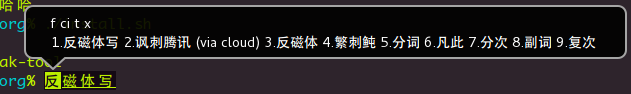

#### 扩展：Edit Desktop Files

- 描述：通过右键单击其应用程序图标编辑 `.desktop` 文件。
- URL：https://extensions.gnome.org/extension/7397/edit-desktop-files/
- 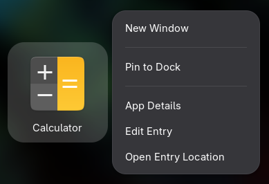

#### 扩展：Auto Move Windows

- 描述：当应用程序创建窗口时，将它们移动到特定的工作区。
- URL：https://extensions.gnome.org/extension/16/auto-move-windows/
- 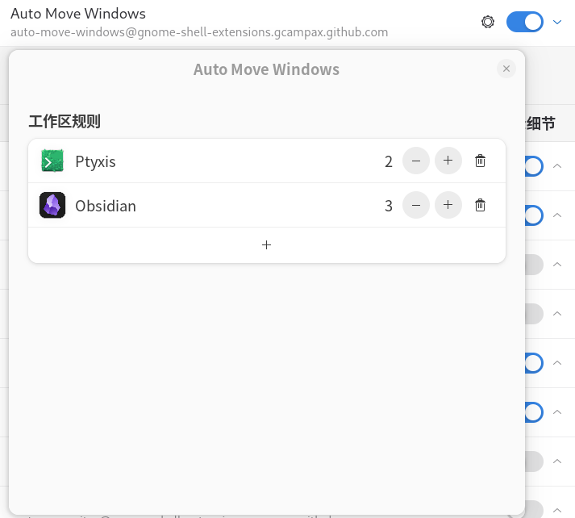

#### 扩展：AppIndicator and KStatusNotifierItem Support

- 描述：这个可以在 _Top Bar（顶栏）_ 显示后台应用图标
- URL：https://extensions.gnome.org/extension/615/appindicator-support/
- 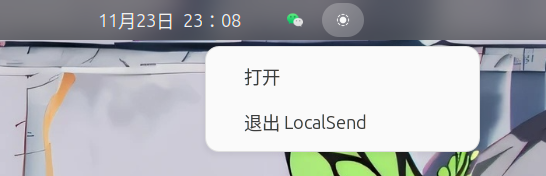

#### 扩展：Coverflow Alt-Tab

- 描述：替代 Alt-Tab 功能，以封面流形式循环切换窗口。
- URL：https://extensions.gnome.org/extension/97/coverflow-alt-tab/
- 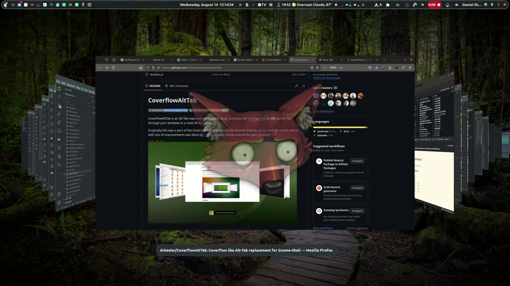

#### 扩展：Compiz alike magic lamp effect

- 描述：神灯效果
- URL：https://extensions.gnome.org/extension/3740/compiz-alike-magic-lamp-effect/
- 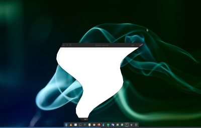

#### 扩展：Dash to Dock

- 描述：在你的 **工作区** 构建一个dock栏
- URL：https://extensions.gnome.org/extension/307/dash-to-dock/
- 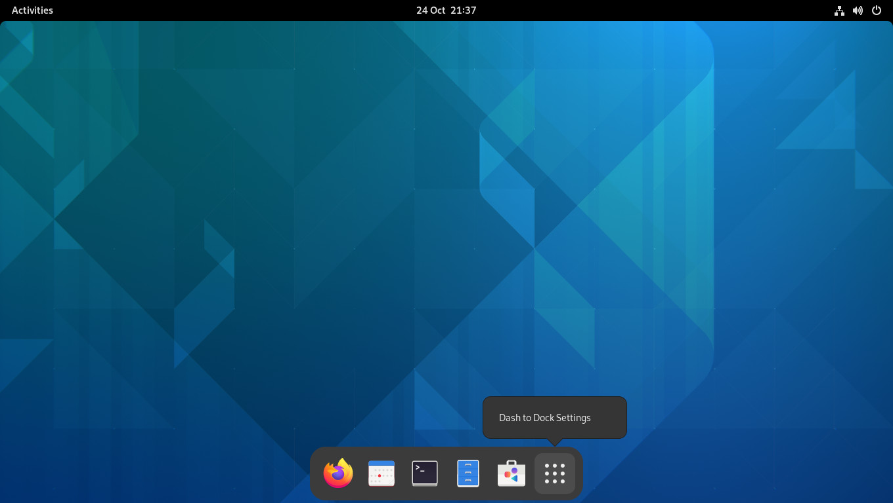

#### 扩展：Blur my Shell（不推荐）

- 描述：为GNOME Shell的不同部分添加模糊外观，包括顶部面板、破折号和概述。
- URL：https://extensions.gnome.org/extension/3193/blur-my-shell/
- 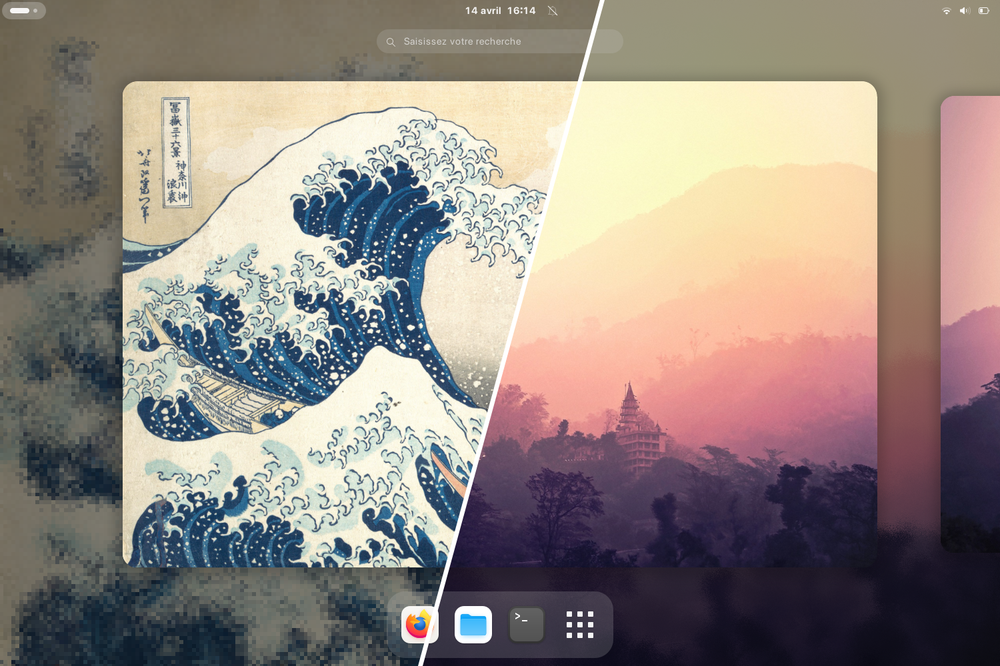

#### 扩展：Clipboard Indicator

- 描述：剪贴板管理器
- URL：https://extensions.gnome.org/extension/779/clipboard-indicator/
- 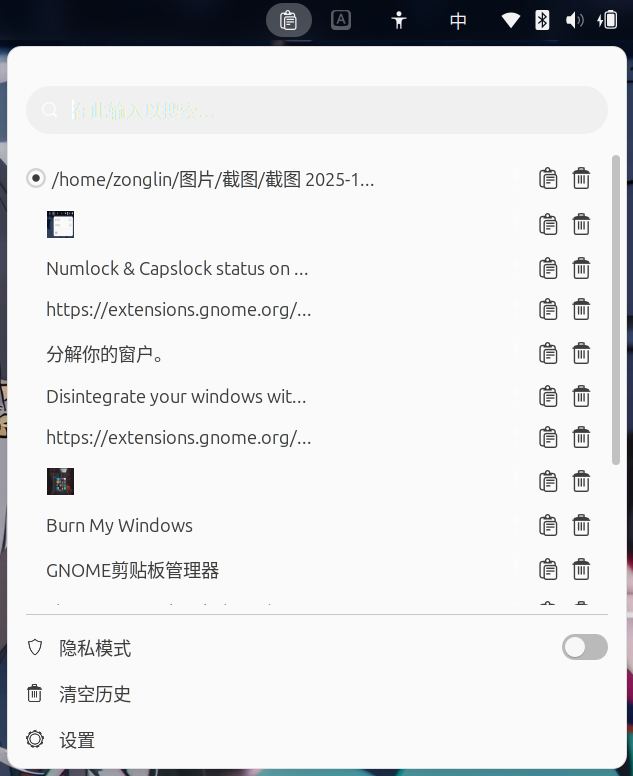

#### 扩展：Burn My Windows

- 描述：分解你的窗户。
- URL：https://extensions.gnome.org/extension/4679/burn-my-windows/
- 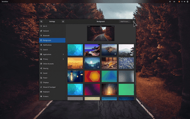

#### 扩展：Lock Keys

- 描述：数字键，大小写切换提示
- URL：https://extensions.gnome.org/extension/36/lock-keys/
- 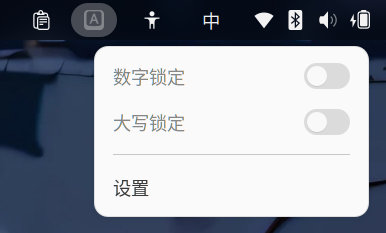

#### 扩展：TopHat

- 描述：可以在顶栏显示系统监控，自定义度挺高的，可以改显示的数据类型等，还可以显
  示CPU每个核心的状态
- URL：https://extensions.gnome.org/extension/5219/tophat/
- 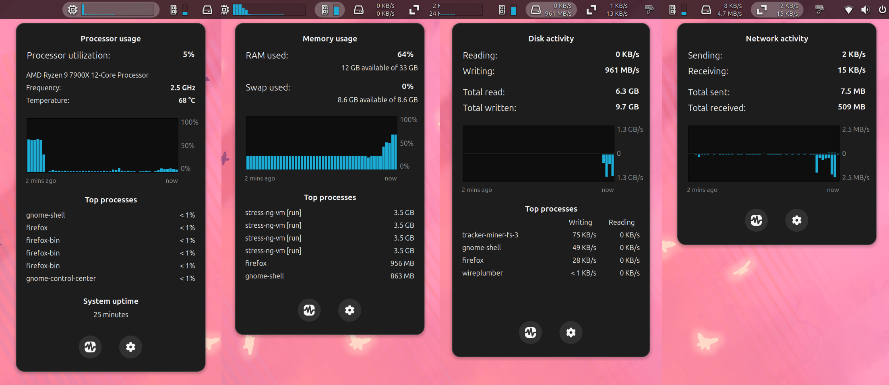

#### 扩展：Removable Drive Menu

- 描述：用于访问和卸载可移动设备的状态菜单。
- URL：https://extensions.gnome.org/extension/7/removable-drive-menu/
- 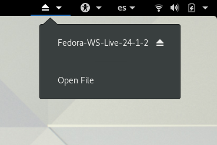

#### 扩展：Input Method Panel

- 描述：输入法面板使用KDE的kimpanel协议Gnome-Shell
- URL：https://extensions.gnome.org/extension/261/kimpanel/
- 