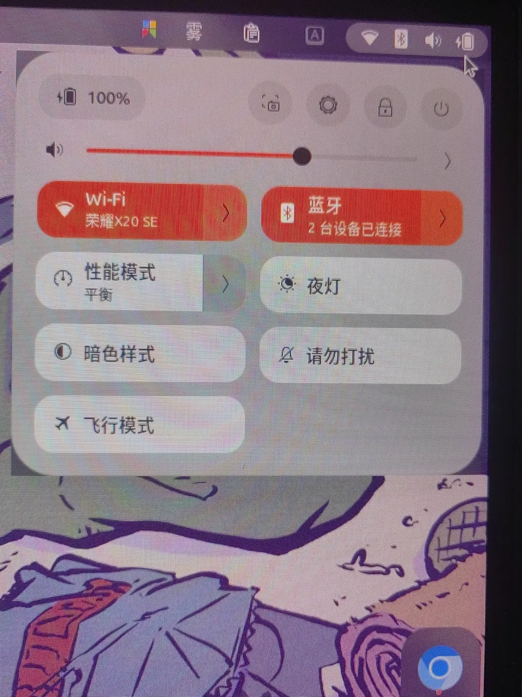

blur-my-shell 图形渲染兼容性问题
---

从提供的图片来看，Ubuntu 26.04 快速设置面板出现了明显的红色/橙色色块与文字重
影，这通常是 Linux 内核 7.0 与 GNOME 50 在部分硬件上出现的图形渲染兼容性问题。

### 🛠️ 排查步骤与解决方案

1. 排查 GNOME 扩展干扰某些扩展（如 `blur-my-shell`）的代码 bug 可能导致残
影。

   - __操作__：进入“扩展”应用禁用`blur-my-shell`扩展，__必须注销并重新登录__。

2. 使用 `journalctl -b | grep -i "gbm_surface\|Failed to query buffer"` 检查的日志输出。