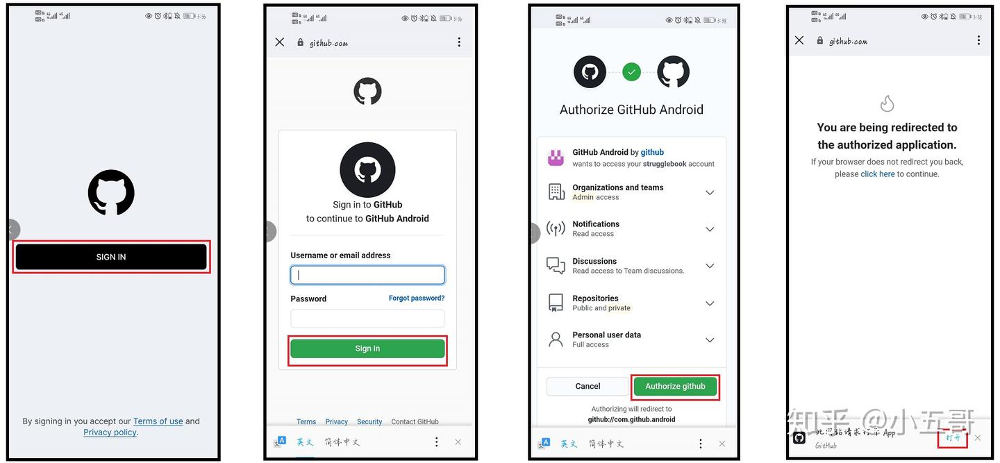
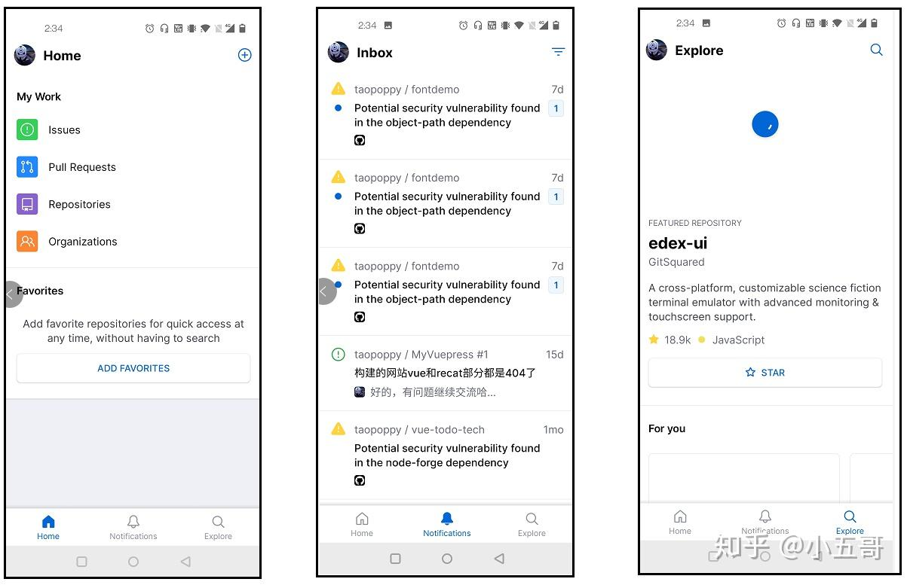

# Github官方APP安装

- [Github 官方APP安装 - 知乎](https://zhuanlan.zhihu.com/p/269463891)

Github官方客户端的介绍
见：[https://github.com/mobile](https://github.com/mobile)，安装方式为 `Google
Play` 和 `Apple` 商店，对于苹果系统来说，使用苹果商店没有问题，但对于国内Android
 用户，访问 `Google Play` 不太容易，安装使用也有很多问题。本文详细介绍一种不使用
`Google Play` 安装使用 Github APP 的方法。

## 1、安装

从以下链接下载 APK 直接安
装：[https://gitclone.com/docs/feature/github_app](https://gitclone.com/docs/feature/github_app)
,也可以从[https://gitclone.com](https://gitclone.com) 首页找到下载链接。需要注意
的是，有些手机装最新版的APP会闪退或干脆装不上去，所以在这个链接地址里，有两个版
本供选择。

- [APKZ 应用商城](https://www.apkz.com/zh_cn.html)

## 2、使用

- 第一步；打开 `Github App`，点击`SIGN IN`登录
- 第二步：点击登录后，会从`App`中跳转到手机默认的浏览器当中，进入`Github`登录网
  址，此时需要输入用户的`Github`账户和密码
- 第三步：成功登录之后，会重定向到`Github`用户授权网址，此时点击`Authorize
  github`进行授权
- 第四步：授权成功后，点击浏览器中的提示，返回到`Github App`，就完成了授权登录

## 3、登录后使用

## 4、其他问题

Github APP 要调用[https://api.github.com/](https://api.github.com/)接口，很多情
况下手机与这个网址是不通的，会报网络错误。