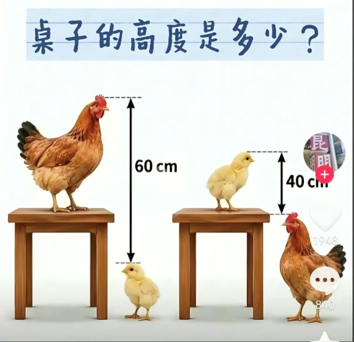

# 📏 经典逻辑题：桌子的高度是多少？

## 📝 题目背景
这是一道经典的数学思维训练题，通过两种不同的摆放方式，求桌子的高度。
*   __左图__：大公鸡站在桌子上，小鸡站在地上，两者头顶的高度差为 __60 cm__。
*   __右图__：小鸡站在桌子上，大公鸡站在地上，两者头顶的高度差为 __40 cm__。
*   __问题__：桌子的高度是多少？

---

## 💡 代数方程法（最严谨）

假设：
*   桌子的高度 = __T__
*   大公鸡的高度 = __R__ (Rooster)
*   小鸡的高度 = __C__ (Chick)

__根据左图：__ 大公鸡在桌上，小鸡在地上。顶端相差 60cm。

> 式子：`(T + R) - C = 60`即：__T + R - C = 60__  —— (方程式 1)

__根据右图：__ 小鸡在桌上，大公鸡在地上。顶端相差 40cm。

> 式子：`(T + C) - R = 40`即：__T + C - R = 40__  —— (方程式 2)

__将两个方程式相加：__

> (T + R - C) + (T + C - R) = 60 + 40

你会发现，`+R` 和 `-R` 抵消了，`-C` 和 `+C` 也抵消了。剩下：

> __2T = 100__ __T = 50__

✅ __结论：桌子的高度是 50 cm。__